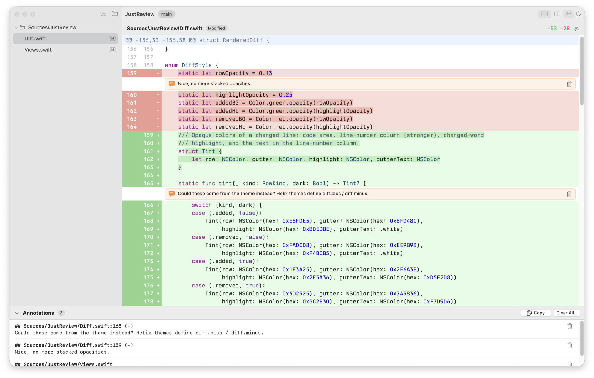
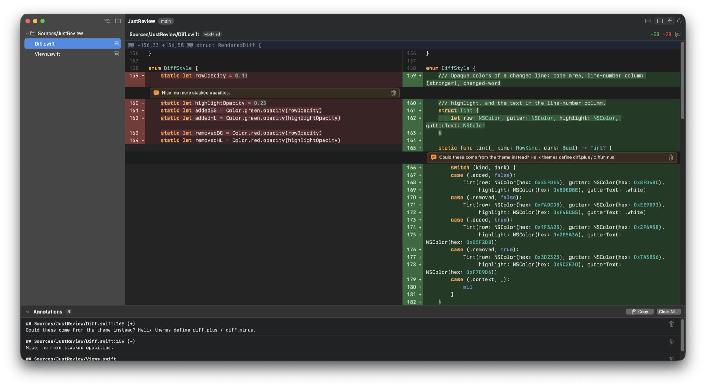

# JustReview

A macOS app for reviewing the changes in a git repository and writing review notes for the LLM
of your choice.

**[Download the latest release](https://github.com/bartTC/JustReview/releases/latest)** for
macOS 15 or later on Apple Silicon.





## Features

- **Everything that changed:** staged, unstaged and untracked files, shown as a tree.
- **Stacked or side-by-side diffs** with changed words highlighted and optional line wrapping,
  just the changed parts or the whole file.
- **Annotations for your LLM:** double-click any line, or a file's name, to leave a note — or
  click a line and just start typing. The note is written right under the line and stays open
  until you save or cancel it.
  Drag across several lines to mark them: typing or a double-click leaves one note for all of them
  (`path:12-18`), ⌘C copies their code without line numbers.
  Copy all notes as Markdown with one click (or ⌘C) and paste them into the LLM of your choice:

  ```
  ## src/utils/permissions.ts:6 (+)
  Should this check the role first?
  ```

  The LLM's changes show up automatically. When it changes an annotated line, that note is
  dropped, so only the open points remain.
- **History:** browse the commits and read each one's changes, every file in one view.
- **Blame:** who last changed each line and when; click a name to see that commit.
- **Syntax highlighting** for Python, JavaScript, TypeScript, JSON, CSS, HTML, Bash, Go, Rust,
  Swift, YAML, Markdown and TOML.
- **Themes:** every [Helix](https://docs.helix-editor.com/themes.html) theme is included. Pick
  one for light mode and one for dark mode, or add your own.
- **Live:** the diff updates as files change on disk.
- **Native macOS:** one window per repository, open any file's diff in its own window, light
  and dark mode.

## Install

Requires macOS 15 or later on Apple Silicon.

Download `JustReview-x.y.z.zip` from the
[latest release](https://github.com/bartTC/JustReview/releases/latest), unzip it and move
`JustReview.app` to Applications. Or build it yourself with the Xcode Command Line Tools:

    ./build.sh                # builds build/JustReview.app

Choose **JustReview → Install Command Line Tool…** to get the `jrev` command:

    jrev                      # review the repository in the current directory
    jrev ~/code/project       # or any other one

## Keyboard shortcuts

| Shortcut | Action |
|---|---|
| ⌥⌘↓ / ⌥⌘↑ | Next / previous change (continues into the next file) |
| ⌥⌘→ / ⌥⌘← | Next / previous file |
| ⌘1 / ⌘2 | Stacked / side by side |
| ⌥Z | Wrap lines |
| ⌥⌘B | Show blame |
| ⌃⌘1 / ⌃⌘2 / ⌃⌘3 | Changes / all files / history |
| ⌘-click | Open a file's diff in its own window |
| ⌥⌘A | Show or hide annotations |
| ⌘C | Copy the marked lines' code, or else the annotations as Markdown |
| ⇧⌘C | Copy annotations as Markdown |
| ⌘↩ | Save the note being written |
| Esc | Cancel the note being written, or unmark lines |
| ⌘R | Clear annotations |
| ⌘O | Open a repository |
| ⌥⌘O | Open the file in its default app |

## License

MIT, see [LICENSE](LICENSE). Bundled grammars and themes keep their own licenses, included next
to them.
